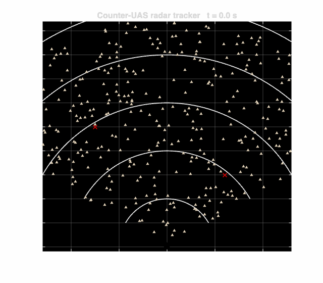
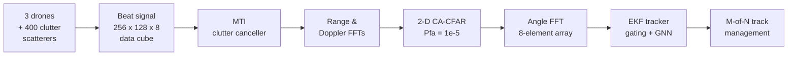
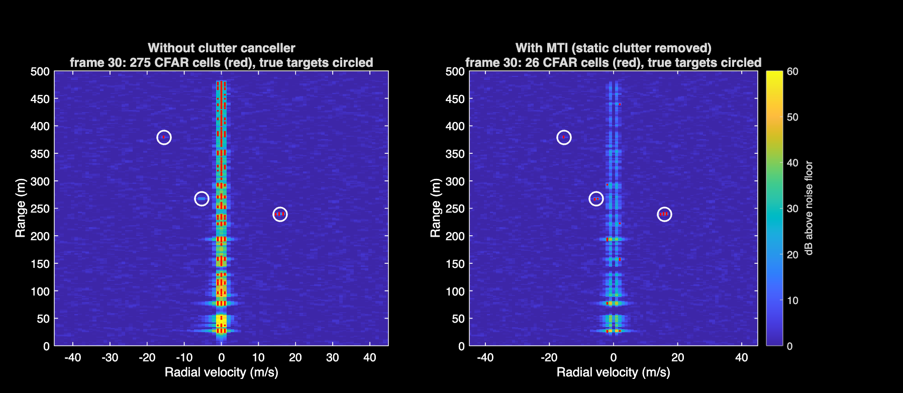
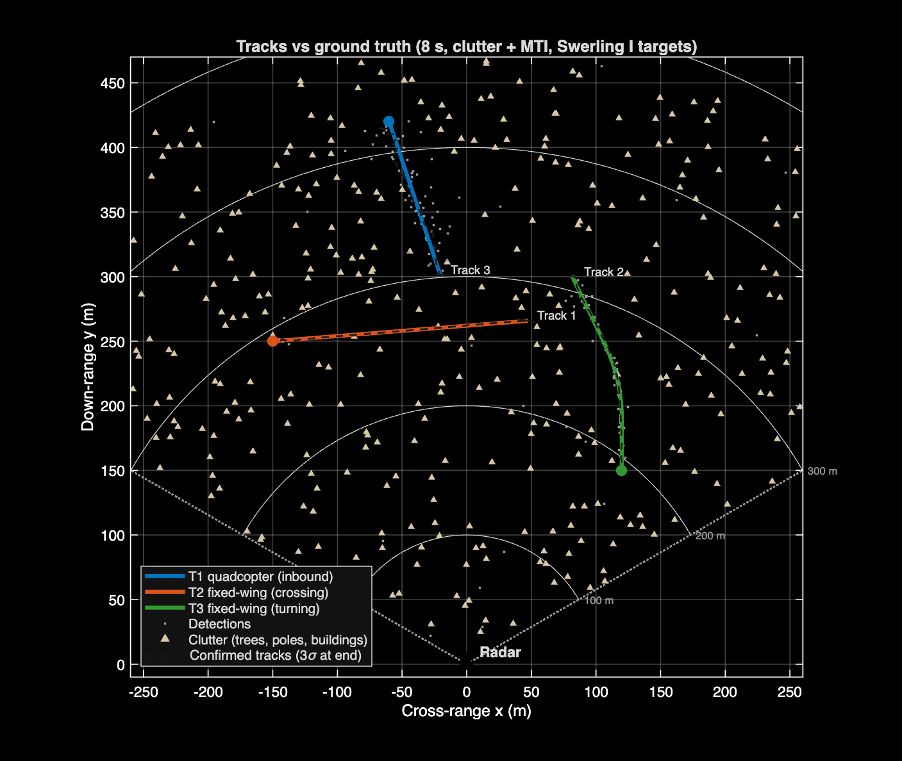
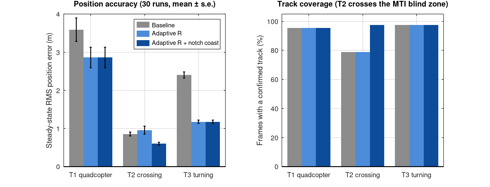
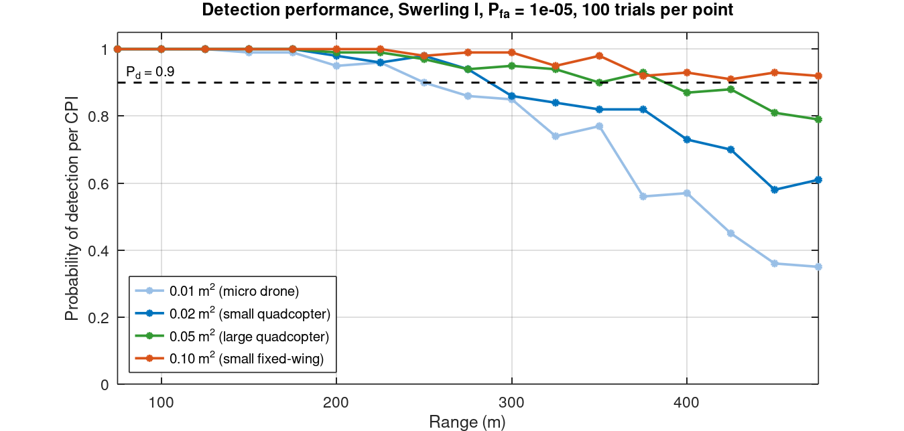
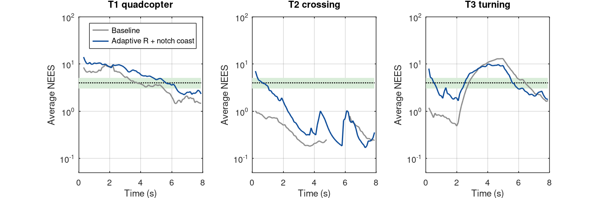
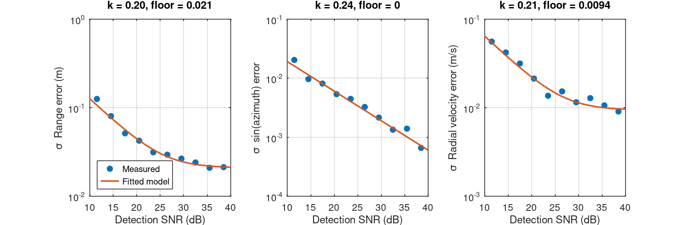

# Counter-UAS Radar Tracker

[](https://github.com/apalangala/cuas-radar-tracker/actions/workflows/ci.yml)

This is a MATLAB simulation of a short-range X-band FMCW radar that detects and tracks small drones in ground clutter. It goes from the raw beat signal all the way to confirmed tracks: Doppler processing, clutter cancellation, CFAR detection, angle estimation across an 8-element array, and a multi-target Extended Kalman Filter.

Everything is written from scratch with no toolboxes, and it also runs in GNU Octave.

<p align="center"></p>

## Why I built this

I build airframes for USyd's Design/Build/Fly team and I'm training for my pilot's licence, so I spend a lot of time thinking about drones from the flying side. I got curious about the opposite problem: how do you find a drone that's small, slow and low when trees and buildings reflect far more energy than it does? It also pulled together most of what I'm studying (signals and systems, electromagnetics, estimation) in one project.

## What I found

These numbers come from 30 paired Monte Carlo runs with clutter, MTI and fluctuating (Swerling I) targets. "Baseline" is a plain EKF. "Improved" adds SNR-based measurement noise and coasting through the MTI blind zone.

| | Baseline | Improved |
|---|---|---|
| Turning drone, RMS position error | 2.40 m | 1.18 m |
| Crossing drone, frames with a confirmed track | 79% (breaks every run) | 98% (no breaks) |
| Crossing drone, RMS velocity error | 2.16 m/s | 0.37 m/s |
| Small quadcopter (0.02 m²), RMS position error | 3.59 m | 2.86 m |
| False confirmed tracks per run | 0 | 0 |

A few other results:

- The MTI clutter canceller takes false detections from about 55 per frame down to 0.3.
- With a 0.5 W transmitter, a 0.02 m² quadcopter is detected (Pd ≥ 0.9) out to about 290 m, and a 0.05 m² one out to about 390 m.
- There are 7 automated tests, run by GitHub Actions on every push.

## How it works



| Stage | What it does | Notes |
|---|---|---|
| Waveform | 10 GHz FMCW, 150 MHz sweep, 128 chirps, 15 ms dwell | 1.95 m range and 0.98 m/s velocity resolution, ±62 m/s unambiguous |
| Signal model | Radar equation, Swerling I targets, 400 clutter scatterers moving in the wind | Clutter is up to 70 dB above the noise |
| MTI | Removes the slow-time mean, i.e. anything stationary | Leaves a ±1.5 m/s blind zone the tracker has to deal with |
| CFAR | 2-D cell-averaging, circular in Doppler | Threshold worked out for 8-channel non-coherent integration |
| Angle | 256-point FFT across the array with sub-bin interpolation | Roughly 0.1 to 1° accuracy depending on SNR |
| Tracker | Constant-velocity EKF, polar measurements, χ² gating, GNN assignment | SNR-adaptive noise, coasting through the blind zone |

The equations, link budget and reasoning behind each choice are in [docs/DESIGN.md](docs/DESIGN.md).

## Results

### Clutter cancellation

Stationary clutter shows up as a bright ridge at zero Doppler and floods the detector. MTI removes it and leaves the three drones.



### Tracking in clutter

Confirmed tracks (dashed) against ground truth, with each track's 3σ ellipse. Each drone keeps one track for the full 8 s, including through the turn and the blind zone.



### Comparing tracker versions

Every tracker version runs on the same detections in each run, so any difference comes from the tracker and not from luck in the detections.



| Target | Tracker | Position RMS (m) | Velocity RMS (m/s) | Coverage | Breaks per run |
|---|---|---|---|---|---|
| T1 quadcopter | Baseline | 3.59 ± 1.69 | 2.93 ± 1.98 | 95% | 0.10 |
| | Adaptive R | 2.86 ± 1.47 | 2.30 ± 1.37 | 95% | 0.00 |
| | Full | 2.86 ± 1.47 | 2.30 ± 1.37 | 95% | 0.00 |
| T2 crossing | Baseline | 0.85 ± 0.28 | 2.16 ± 1.05 | 79% | 1.00 |
| | Adaptive R | 0.96 ± 0.57 | 2.33 ± 1.31 | 79% | 1.00 |
| | Full | 0.60 ± 0.20 | 0.37 ± 0.12 | 98% | 0.00 |
| T3 turning | Baseline | 2.40 ± 0.44 | 2.49 ± 0.15 | 98% | 0.00 |
| | Adaptive R | 1.18 ± 0.24 | 1.62 ± 0.13 | 97% | 0.07 |
| | Full | 1.18 ± 0.24 | 1.62 ± 0.13 | 97% | 0.07 |

The ± values are standard deviations across the 30 runs. The first second of each track is left out so the numbers are steady-state.

### Detection range



| Target | RCS | Range at Pd ≥ 0.9 |
|---|---|---|
| Micro drone | 0.01 m² | ~250 m |
| Small quadcopter | 0.02 m² | ~290 m |
| Large quadcopter | 0.05 m² | ~390 m |
| Small fixed-wing | 0.10 m² | 475 m or more (edge of coverage) |

### Filter consistency

NEES checks whether the filter's own uncertainty matches its actual error. It should stay inside the green 95% band.



It doesn't always. The crossing drone sits below the band, meaning the filter is under-confident, because the process noise is set for manoeuvres this target never makes. The turning drone goes above the band during the turn, because a constant-velocity model can't keep up with a 3 m/s² turn. One motion model can't suit both kinds of target, which is why an IMM filter is next on the list.

## Problems I ran into

1. **The CFAR threshold was wrong by 5.5 dB.** The textbook CA-CFAR formula assumes single-channel (exponential) noise. Summing 8 channels makes the noise Gamma(8), so the real false-alarm rate was around 10⁻³⁰ instead of 10⁻⁵, and the smallest drone disappeared. I solved for the right threshold numerically and added a test that measures Pfa.

2. **The blind zone was too wide.** With 64 chirps the velocity resolution was 3.9 m/s, which made the MTI blind zone ±6 m/s, and the crossing drone vanished for 5 s. I didn't need ±125 m/s max velocity, so I traded it for a longer dwell. That gave 4x finer resolution, 3 dB more gain and a ±1.5 m/s blind zone.

3. **Guessing measurement noise wasn't good enough.** `run_calibration.m` measures error against SNR. It follows the resolution/√SNR relationship, so the tracker now uses that fit to weight each detection on its own.

4. **A near-perfect measurement made the filter overconfident.** Almost noise-free Doppler pushed NEES to about 30 through the nonlinear coupling between range-rate and position. Real drones have micro-Doppler spread anyway, so I set a 0.15 m/s floor.



## Running it

```matlab
setup_paths
run_demo           % one scenario and all figures (~30 s)
run_monte_carlo    % 30-run comparison (~5 min)
run_pd_curve       % detection range vs target size (~3 min)
run_calibration    % measurement accuracy vs SNR (~1 min)
run_tests          % the 7 tests (~5 s)
```

Figures go to `docs/img/`. Every run is seeded, so the results are reproducible.

## Folder layout

```
run_demo.m          single scenario, end to end
run_monte_carlo.m   Monte Carlo comparison of tracker versions
run_pd_curve.m      Pd vs range for four target sizes
run_calibration.m   measurement error vs SNR
src/radar/          parameters, scenario, clutter, data cube
src/processing/     MTI, range-Doppler, CFAR, angle estimation
src/tracking/       EKF, measurement model, gating, track management
src/sim/            scenario runner, seeding
src/eval/           track scoring, NEES
src/viz/            figures and GIF
tests/              test suite
docs/DESIGN.md      design notes, link budget, equations
```

## Limits and next steps

Drones are modelled as single points, it's 2-D only, and the hardware is ideal. The next thing I want to add is an IMM filter, to fix the consistency problem above.

## References

- M. A. Richards, *Fundamentals of Radar Signal Processing*, 2nd ed., McGraw-Hill, 2014
- Y. Bar-Shalom, X. R. Li, T. Kirubarajan, *Estimation with Applications to Tracking and Navigation*, Wiley, 2001
- M. I. Skolnik, *Introduction to Radar Systems*, 3rd ed., McGraw-Hill, 2001
- S. Rao, *Introduction to mmWave Sensing: FMCW Radars*, Texas Instruments, 2017

## Licence

MIT. See [`LICENSE`](LICENSE).

*Developed with AI assistance from Claude.*
